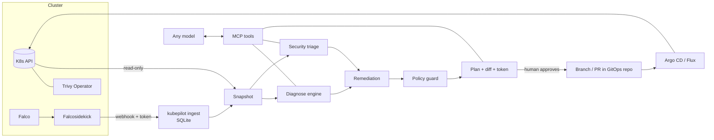

# kubepilot

[](https://github.com/OWNER/kubepilot/actions/workflows/ci.yml)


**An AI ops layer for Kubernetes: it diagnoses failures across every layer (edge, apps, data, logging, TLS), triages security signals, and proposes fixes as Git branches/PRs. It never changes the cluster itself.**

kubepilot is an [MCP](https://modelcontextprotocol.io) server, so it works with any MCP client (Claude Code, Claude Desktop, other agents). The analysis — root cause, signal correlation, risk scoring, policy checks — is deterministic, tested code in the server; the model only explains and asks you to approve.

```
You:  "Why is checkout failing? Prepare a fix."

AI → diagnose_workload(shop/checkout) → plan_remediation

AI:  checkout is OOMKilled (10 restarts). Revision 2, rolled out at 21:28, lowered the memory
     limit from 512Mi to 128Mi — that's the cause.

     --- a/checkout.yaml
     +++ b/checkout.yaml
     -              memory: 128Mi
     +              memory: 512Mi

     Policy check passed. Committing creates a branch for review; nothing is applied to the
     cluster. Commit plan 06cb74424674?
```
*(Real output from the k3s test lab, lightly trimmed.)*

## Why it's different

| | Typical "AI for K8s" | kubepilot |
|---|---|---|
| Changes | Agent runs `kubectl apply`, or no fixes at all | **Git branch / PR** → your Argo CD / Flux applies it after review; rollback = `git revert` |
| Cluster access | Often broad | Only reads. In-cluster it ships a **read-only ClusterRole** (no Secrets, exec, logs or writes) and warns if it runs with more |
| Security | Afterthought | Falco + Trivy + RBAC + NetworkPolicy **correlated** into scored, explained incidents |
| Model | Usually one vendor | **Any MCP client**; the logic lives in the server |
| Guardrails | Prompting | Policy guard, plan expiry, stale-plan detection, approval token, optional human CLI approval, dry-run by default |
| Prompt injection | Ignored | All cluster text is sanitized and injection attempts are **flagged** as data |
| Layers | Pods only | **Edge** (ingress-nginx + ModSecurity, Kong), **data** (Kafka, RabbitMQ, OpenSearch/Elasticsearch, Redis, PostgreSQL, MongoDB), **log pipeline** (Fluent Bit, Fluentd, Vector), **routing and TLS** — and it traces a failure across them to the real cause |

## It understands every layer, not just pods

An app rarely fails alone. kubepilot models the layers around it and follows failures across them:

```
 users ──► edge (ingress-nginx + ModSecurity, Kong) ──► Ingress ──► Service ──► app pods
                                                                              │
                         log pipeline (Fluent Bit / Fluentd / Vector) ◄───────┤
                                         │                                    ▼
                                         └──────────► data (Kafka, RabbitMQ, OpenSearch, Redis, Postgres, Mongo)
                                                      + TLS certificates (cert-manager)
```

It detects each component from operator resources (Strimzi, RabbitMQ operator, OpenSearch operator, ECK,
CloudNativePG, Zalando, MongoDB community, OT Redis), Helm releases, plain StatefulSets/Deployments/DaemonSets
and container images — and checks what actually breaks them:

```
You:  "Why is orders crashing?"

AI → diagnose_workload(shop/orders) → diagnose_component(data/events) → plan_remediation(data/events)

AI:  orders is not the problem. It writes to Kafka data/events (env KAFKA_BOOTSTRAP_SERVERS) and its logs
     show NotEnoughReplicasException. events has 2/3 brokers ready — broker 2's volume is Pending — and
     min.insync.replicas = 3 = replication factor, so a single missing broker blocks every acks=all write.
     Restarting orders won't help.

     --- a/apps/data/kafka.yaml
     +++ b/apps/data/kafka.yaml
     -      min.insync.replicas: 3
     +      min.insync.replicas: 2

     Strimzi will roll the brokers one at a time. Commit plan 3f9c1e0a2b7d?
```
*(From the bundled demo: `kubepilot demo-diagnose shop orders`.)*

| System | Checks (deterministic, each with evidence) |
|---|---|
| All | members ready / down, operator status conditions, PVC Pending/Lost, ephemeral storage, single instance, PDB missing, members on one node, no memory limit, no NetworkPolicy, client/admin port exposed via LoadBalancer/NodePort |
| Kafka | RF > brokers, min.insync ≥ RF, fewer brokers than min.insync, RF 1, offsets topic RF, plaintext external listener, JVM heap vs limit |
| OpenSearch / Elasticsearch | cluster health red/yellow, JVM heap vs limit (≤ 50%), security plugin disabled, single-node discovery |
| RabbitMQ | even member count (quorum), management UI exposed |
| Redis | no password / protected mode off |
| PostgreSQL | `trust` auth, multi-replica *Deployment* (split brain) |
| MongoDB | auth disabled |
| **ingress-nginx** | IngressNightmare-vulnerable version (CVE-2025-1974) → upgrade PR · project retired (no fixes after March 2026) · `allow-snippet-annotations` on · **ModSecurity** in DetectionOnly (not blocking) → blocking PR · CRS not loaded · WAF disabled per Ingress · controller down = which hosts are unreachable |
| **Kong** | Admin API / Kong Manager exposed (LoadBalancer/NodePort) → ClusterIP PR · Admin API on 0.0.0.0 without TLS or NetworkPolicy · route references a missing KongPlugin (auth not applied) · `local` rate limits multiplied by replica count |
| **Fluent Bit** (Fluentd, Vector: coverage) | nodes without a log agent (untolerated taints) → toleration PR · `Retry_Limit` default 1 drops logs → PR · no `Mem_Buf_Limit` → PR · logs leaving the cluster without TLS · credentials inline in the ConfigMap · **destination unhealthy → logs not delivered** |
| **Routing** | Ingress → missing Service · Ingress → Service with no ready pods (users get 503), linked to the broken workload |
| **Certificates** (cert-manager) | expired · expiring within 7 days (renewal failing, with the ACME error) · not ready |

Connections are inferred from env var values that point at a Service (`redis://cache.data:6379`,
`kafka-0.kafka-brokers:9092`, …), from log agent outputs, and from Ingress backends. Env values and ConfigMap
contents are parsed in memory and **never returned** (they often embed passwords); only names are shown.

## Try it in 1 minute (no cluster needed)

Requires [uv](https://docs.astral.sh/uv/) and git.

```bash
git clone https://github.com/OWNER/kubepilot && cd kubepilot
uv run kubepilot demo                       # triage a bundled, deliberately broken cluster
uv run kubepilot demo-diagnose shop checkout
```

### Let an AI fix it

```bash
uv run kubepilot demo --setup ./kubepilot-demo
```

This creates a demo GitOps repo and prints a ready-to-paste config. For Claude Code:

```bash
claude mcp add --scope user kubepilot-demo -e KUBEPILOT_SOURCE=fixture ... -- uv --directory $PWD run kubepilot serve
```

(Use the exact command `demo --setup` prints. `--scope user` makes it available from any folder.)
Then ask: *"Triage the cluster"* · *"Why is checkout failing? Prepare a fix."* · *"Treat payment-api as an incident."*

> kubepilot runs as a **local** MCP server (stdio). Use it from a client running on the same machine,
> such as Claude Code or Claude Desktop's local MCP config. Cloud-hosted chat sessions can't reach it.

### With a local model (no MCP client)

```bash
ollama pull qwen2.5:7b-instruct
KUBEPILOT_SOURCE=fixture kubepilot ask "Why is shop/orders crashing?" --model qwen2.5:7b-instruct
```

Works with any OpenAI-compatible endpoint (Ollama, LM Studio, vLLM, llama.cpp, hosted APIs). The model can plan
fixes but never commit them; you run `kubepilot commit <plan-id>` yourself. → [docs/LOCAL-MODELS.md](docs/LOCAL-MODELS.md)

### On your real cluster

```bash
uv run kubepilot serve        # uses your current kube-context (or KUBEPILOT_KUBE_CONTEXT)
```

Set `KUBEPILOT_GITOPS_REPO` to a local clone of your GitOps repo to enable fixes. Prefer a **read-only identity**
(see `deploy/rbac.yaml`); kubepilot reports a warning if its credentials can write or read Secrets.

## Tested on a real cluster

The whole loop was validated on a single-node **k3s** lab (Ubuntu VM) with Falco (modern eBPF) and the Trivy Operator,
driven by Claude Code: diagnosis → rollout correlation → Falco attack detection → plan → human approval → branch →
merge → workload healthy. The lab is reproducible:

```bash
make lab-k3s                       # Ubuntu box/VM: k3s, Falco, Trivy Operator, broken workloads
make lab-ingest                    # separate terminal: receive Falco alerts
make lab-verify PHASE=baseline     # automated PASS/WARN/FAIL checks
make lab-break  && make lab-verify PHASE=broken
make lab-attack && make lab-verify PHASE=attacked
```

Runbook, expected results and troubleshooting: [docs/TESTING.md](docs/TESTING.md).

## How it works



**Diagnosis rules:** OOMKilled (correlated with the rollout that changed limits) · CrashLoopBackOff with exit-code meaning · image pull failures (not found / auth / network) · missing Secret/ConfigMap · unschedulable (request larger than any node, taints, affinity, PVC) · liveness/readiness probe failures · high restarts · unhealthy nodes · config hygiene.

**Security triage:** per-workload score from Falco runtime alerts, Trivy CVEs, privileged/root/host access, missing NetworkPolicies and risky ServiceAccount RBAC, ×1.5 when runtime activity hits an exploitable or over-privileged workload. Every point is explained → [docs/scoring.md](docs/scoring.md). Known-benign alerts are suppressed with an [allowlist](src/kubepilot/demo/allowlist.yaml); platform namespaces (kube-system, falco, trivy-system) are hidden from cluster-wide security views unless you ask.

**Root cause across dependencies:** when an app fails and a data system it uses is unhealthy, the first finding says so ("Likely root cause: Kafka data/events is unhealthy"). With `KUBEPILOT_READ_LOGS=true` kubepilot also reads the last 200 lines of *failing* containers and extracts known error signatures (OOM, NotEnoughReplicas, connection refused, DNS, auth, disk full, …) to pick the right dependency. Logs are untrusted: only a signature and one sanitized line are returned, never the log.

**Automated fixes (as Git changes):** `set-memory-limit` · `set-memory-request` · `set-image` · `rollback-template` · `harden-security-context` · `restrict-ingress` (scoped to known client namespaces) · `isolate-workload` · `add-pdb` · `make-service-internal` · `set-kafka-config` · `set-modsecurity-blocking` · `set-fluentbit-option` · `add-toleration`. Several fixes to the same file land in one coherent change. They edit plain manifests, Kustomize bases, **operator custom resources** (Kafka, RabbitmqCluster, CNPG Cluster, …) and **Helm values** (Argo CD `valuesObject`/`valueFiles`, Flux `HelmRelease.spec.values`, `<release>/values*.yaml`) — a Helm value is changed only where its current content matches what is live, otherwise kubepilot refuses. Edits keep comments and formatting; new files are registered in `kustomization.yaml`. Everything else (rotate credentials, enable auth, rebuild an image, reduce RBAC, create a missing Secret) is returned as guidance for a human.

**After the merge:** `verify_fix` checks the plan's commit reached the base branch (also after squash merges), reads Argo CD sync/health, and confirms the targeted findings are gone. `plan_revert` creates a reviewed revert plan when a change made things worse.

## MCP tools

| Tool | Type | Purpose |
|---|---|---|
| `cluster_health` | read | Start here: broken workloads, high-risk incidents, components per layer, routing & TLS, nodes |
| `find_problems` | read | All findings above a severity |
| `diagnose_workload` | read | Root cause (incl. broken dependencies and log signatures) + rollout diff + fix options |
| `list_components` | read | Components by layer (edge, data, logging): how managed, members ready, status, clients |
| `diagnose_component` | read | Checks with evidence and fixes for one component; routes for edge, destinations for log agents |
| `security_triage` | read | Ranked, correlated security incidents |
| `investigate_security` | read | RBAC, NetworkPolicy, security context, CVEs for one workload |
| `recent_events` | read | Warning events, sanitized |
| `plan_remediation` | plan | Diff + policy result + notes + approval token (writes nothing) |
| `commit_plan` | write (Git only) | Commit an approved plan to a new branch / PR |
| `verify_fix` | read | Merged? synced? findings gone? |
| `plan_revert` | plan | Revert plan for a committed change (same approval flow) |
| `list_plans`, `change_history` | read | Plans and audit log |

Prompts: `triage_cluster`, `fix_workload`, `incident_response`.

## Configuration

| Variable | Default | |
|---|---|---|
| `KUBEPILOT_SOURCE` | `kube` | `kube` or `fixture` |
| `KUBEPILOT_FIXTURE_DIR` | bundled demo | fixture directory (see `kubepilot capture`) |
| `KUBEPILOT_KUBE_CONTEXT` | current | kube-context to use |
| `KUBEPILOT_ALERTS_DB` | — | SQLite file written by `kubepilot ingest` |
| `KUBEPILOT_ALLOWLIST` | — (bundled one in demo mode) | Falco allowlist YAML |
| `KUBEPILOT_SYSTEM_NAMESPACES` | `kube-system,kube-public,kube-node-lease,falco,trivy-system` | hidden from cluster-wide security views |
| `KUBEPILOT_GITOPS_REPO` | — | local clone; enables plan/commit |
| `KUBEPILOT_DRY_RUN` | `true` | `false` to actually commit |
| `KUBEPILOT_GITOPS_PUSH` | `false` | push the branch and open a PR with `gh` |
| `KUBEPILOT_APPROVAL_MODE` | `token` | `cli` additionally requires `kubepilot approve <id>` by a human |
| `KUBEPILOT_PLAN_TTL_MINUTES` | `30` | plan expiry |
| `KUBEPILOT_INGEST_TOKEN` | — | **required** bearer token for the Falco webhook |
| `KUBEPILOT_LLM_MODEL`, `KUBEPILOT_LLM_BASE_URL`, `KUBEPILOT_LLM_API_KEY` | —, Ollama, — | for `kubepilot ask` |
| `KUBEPILOT_READ_LOGS` | `false` (`true` in fixture mode) | read error signatures from failing containers' logs; needs the optional `kubepilot-logs` ClusterRole in `deploy/rbac.yaml` |

## CLI

```
kubepilot demo [--setup DIR]               try it on the bundled broken cluster
kubepilot serve [--transport stdio|http]   MCP server (HTTP binds 127.0.0.1 by default)
kubepilot ingest                           Falcosidekick webhook receiver (needs KUBEPILOT_INGEST_TOKEN)
kubepilot triage [ns] [--security]         JSON report
kubepilot diagnose <ns> <name>
kubepilot ask "<question>" [--model M]   agent loop with a local/OpenAI-compatible model
kubepilot plans | show <id> | approve <id> | reject <id>
kubepilot commit <id>                      human-only commit (interactive terminal required)
kubepilot capture --out DIR [-n ns]        snapshot a cluster into a fixture (env values etc. redacted)
```

## Status and limitations

kubepilot is **alpha**. Known limits:
- Helm: values are edited, chart templates never; a value the chart only sets by default must be set explicitly first. The rendered diff is checked by your CD tool, not by kubepilot's policy guard.
- Operator support (CRD versions, labels, status fields) was verified against the operators' source in Oct 2026 ([platform notes](docs/platform-notes.md)), not yet against every live operator version. Operators not on the list are seen as plain StatefulSets.
- Checks read Kubernetes state only (no client connections): topic-level settings, consumer lag, shard allocation and live WAF/gateway metrics are out of scope.
- Edge: ingress-nginx and Kong today. Gateway API (HTTPRoute), Traefik, Envoy Gateway, Istio and NGINX Inc.'s controller are next. Fluent Bit YAML configs are checked but only classic `.conf` is edited automatically; Fluent Operator CRDs are not read yet.
- Rollback compares image and resources only, not env/args/probes.
- Tested end to end with Claude. `kubepilot ask` makes local models usable, but they are not benchmarked yet.
- The Falco alert store is local SQLite (single replica).

## Roadmap
Gateway API / Traefik / Envoy Gateway / Istio · Prometheus & Loki pipelines · Flux status in `verify_fix` · automatic revert-PR on regression · ephemeral verification in vcluster/kind before the PR · Cilium Hubble flow analysis → least-privilege NetworkPolicies from real traffic · Kyverno policy reuse · OpenCost rightsizing · multi-cluster view · eval harness comparing local and frontier models.

## Contributing & security
Issues and PRs welcome: see [CONTRIBUTING.md](CONTRIBUTING.md). Please report vulnerabilities privately, per [SECURITY.md](SECURITY.md).
Design notes: [DECISIONS.md](DECISIONS.md) · [docs/platform-notes.md](docs/platform-notes.md) · [docs/scoring.md](docs/scoring.md)

License: Apache-2.0
