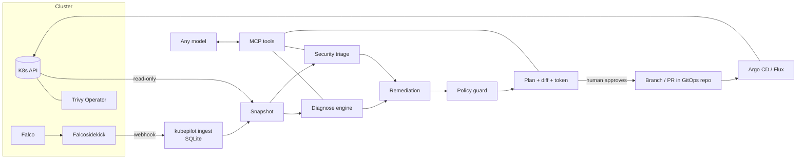

# kubepilot

**An AI ops layer for Kubernetes that diagnoses, triages security, and proposes fixes as Git pull requests — never touching the cluster directly.**

kubepilot is a model-agnostic [MCP](https://modelcontextprotocol.io) server. Plug it into Claude, GPT, or a small local model via Ollama: the hard work (root-cause analysis, signal correlation, risk scoring, policy checks) is done by deterministic, tested code in the server, so even a 7B model gives good answers.

```
You:  "Checkout is broken and something looks off with payments."

AI → cluster_health → diagnose_workload(shop/checkout) → investigate_security(shop/payment-api)

AI:  checkout — OOMKilled (12 restarts). Revision 2, rolled out at 09:10, lowered the memory
     limit from 512Mi to 256Mi; that's the cause. Proposed fix: restore 512Mi (diff below).

     payment-api — CRITICAL (score 100), likely compromise: shell spawned at 09:12, /etc/shadow
     read, unknown binary executed from /tmp. Image has CVE-2024-45337 (critical, fixed in
     golang.org/x/crypto 0.31.0); runs as root; no NetworkPolicy; its ServiceAccount can read
     every secret in `shop`. Contain first: I can prepare an isolation NetworkPolicy as a PR.
     Approve?
```

## Why it's different

| | Typical "AI for K8s" | kubepilot |
|---|---|---|
| Changes | `kubectl apply` by the agent, or none | **Git branch / PR** → your Argo CD / Flux applies after review; rollback = `git revert` |
| Cluster access | Often broad | **Read-only ClusterRole** (no Secrets, exec, logs, or writes) |
| Security | Afterthought | Falco + Trivy + RBAC + NetworkPolicy **correlated** into scored incidents |
| Model | Usually one vendor | **Any MCP client**; logic lives in the server |
| Guardrails | Prompting | Policy guard, plan expiry, stale-plan detection, approval token, optional CLI approval, dry-run default |
| Prompt injection | Ignored | All cluster text sanitized and injection attempts **flagged** |

## Quickstart (no cluster needed, 2 minutes)

Requires [uv](https://docs.astral.sh/uv/) and git (works on Linux, macOS, Windows/WSL2).

```bash
make install
make demo        # health + security triage of the bundled demo cluster
make test        # 95 tests, ~5 s
```

### Connect it to Claude (or any MCP client)

```bash
make demo-repo   # scratch git copy of examples/gitops-repo for plan/commit
```

Claude Desktop / Claude Code config (`mcpServers`):

```json
{
  "mcpServers": {
    "kubepilot": {
      "command": "uv",
      "args": ["--directory", "/path/to/kubepilot", "run", "kubepilot", "serve"],
      "env": {
        "KUBEPILOT_SOURCE": "fixture",
        "KUBEPILOT_FIXTURE_DIR": "/path/to/kubepilot/examples/demo-cluster",
        "KUBEPILOT_ALLOWLIST": "/path/to/kubepilot/examples/allowlist.yaml",
        "KUBEPILOT_GITOPS_REPO": "/path/to/kubepilot/.demo/repo",
        "KUBEPILOT_STATE_DIR": "/path/to/kubepilot/.demo/state",
        "KUBEPILOT_DRY_RUN": "false"
      }
    }
  }
}
```

Then try: *"Triage the cluster"* · *"Why is checkout failing? Prepare a fix."* · *"Treat payment-api as an incident."*

For a real cluster, drop `KUBEPILOT_SOURCE`/`KUBEPILOT_FIXTURE_DIR`; kubepilot uses your current kube-context (or `KUBEPILOT_KUBE_CONTEXT`).

**Local models:** any MCP-capable client that talks to Ollama/llama.cpp works the same way; point it at `kubepilot serve` over stdio, or `kubepilot serve --transport http` (→ `http://127.0.0.1:8765/mcp`).

### Real cluster lab (kind + Falco + Trivy)

```bash
make lab-up            # kind cluster, Falco (modern eBPF) + Falcosidekick, Trivy Operator, broken workloads
make ingest            # receive Falco alerts on :2801 (separate terminal)
./lab/attack.sh        # benign attack simulation
```

## How it works



### Diagnosis rules
OOMKilled (correlated with the rollout that changed limits) · CrashLoopBackOff with exit-code meaning · image pull failures (not found / auth / network) · missing Secret/ConfigMap · unschedulable (requests larger than any node, taints, affinity, PVC) · liveness/readiness probe failures · high restarts · unhealthy nodes · config hygiene.

### Security triage
Per-workload score from Falco runtime alerts, Trivy CVEs, privileged/root/host access, missing NetworkPolicies and risky ServiceAccount RBAC, with a ×1.5 multiplier when runtime activity hits an exploitable or over-privileged workload. Every point is explained → [docs/scoring.md](docs/scoring.md). Known-benign alerts are suppressed via [an allowlist](examples/allowlist.yaml).

### Automated remediations (as Git changes)
`set-memory-limit` · `set-memory-request` · `set-image` · `rollback-template` · `harden-security-context` · `restrict-ingress` · `isolate-workload`. Edits preserve comments and formatting; new files are registered in `kustomization.yaml`. Everything else (rotate credentials, rebuild image, reduce RBAC, create missing secret) is returned as manual guidance; kubepilot never creates secrets or edits RBAC on its own.

## MCP tools

| Tool | Type | Purpose |
|---|---|---|
| `cluster_health` | read | Start here: broken workloads, high-risk incidents, nodes |
| `find_problems` | read | All findings above a severity |
| `diagnose_workload` | read | Root cause + rollout diff + remediation options |
| `security_triage` | read | Ranked, correlated security incidents |
| `investigate_security` | read | RBAC, NetworkPolicy, security context, CVEs for one workload |
| `recent_events` | read | Warning events, sanitized |
| `plan_remediation` | plan | Diff + policy result + notes + approval token (no writes) |
| `commit_plan` | write (Git) | Commit an approved plan to a new branch / PR |
| `list_plans`, `change_history` | read | Plans and audit log |

Prompts: `triage_cluster`, `fix_workload`, `incident_response`.

## Configuration

| Variable | Default | |
|---|---|---|
| `KUBEPILOT_SOURCE` | `kube` | `kube` or `fixture` |
| `KUBEPILOT_FIXTURE_DIR` | bundled demo | fixture directory (see `kubepilot capture`) |
| `KUBEPILOT_KUBE_CONTEXT` | current | kube-context to use |
| `KUBEPILOT_ALERTS_DB` | — | SQLite file written by `kubepilot ingest` |
| `KUBEPILOT_ALLOWLIST` | — | Falco allowlist YAML |
| `KUBEPILOT_GITOPS_REPO` | — | local clone; enables plan/commit |
| `KUBEPILOT_DRY_RUN` | `true` | `false` to actually commit |
| `KUBEPILOT_GITOPS_PUSH` | `false` | push branch and open PR with `gh` |
| `KUBEPILOT_APPROVAL_MODE` | `token` | `cli` requires `kubepilot approve <id>` by a human |
| `KUBEPILOT_PLAN_TTL_MINUTES` | `30` | plan expiry |
| `KUBEPILOT_INGEST_TOKEN` | — | bearer token for the Falco webhook |

## CLI

```
kubepilot serve [--transport stdio|http]   MCP server
kubepilot ingest                           Falcosidekick webhook receiver
kubepilot triage [ns] [--security]         JSON report
kubepilot diagnose <ns> <name>
kubepilot plans | show <id> | approve <id> | reject <id>
kubepilot capture --out DIR [-n ns]        snapshot a live cluster into a fixture (no Secrets)
```

## Limitations (v1)
- GitOps repos with plain manifests or Kustomize; Helm-templated files are skipped (values-file editing is planned).
- Rollback compares image and resources only, not env/args/probes.
- Pod logs are not read (prompt-injection surface; planned behind stronger sanitization).
- Falco alert store is local SQLite (single replica).

## Roadmap
Helm values editing · Argo CD / Flux sync & health watch after merge (auto-revert PR on regression) · ephemeral verification in vcluster/kind before the PR · Cilium Hubble flow analysis → least-privilege NetworkPolicies from real traffic · Kyverno policy reuse · OpenCost rightsizing · multi-cluster view · eval harness scoring local vs frontier models.

## Project docs
[CLAUDE.md](CLAUDE.md) (working rules) · [DECISIONS.md](DECISIONS.md) · [SECURITY.md](SECURITY.md) · [docs/platform-notes.md](docs/platform-notes.md) · [docs/scoring.md](docs/scoring.md)

License: Apache-2.0
